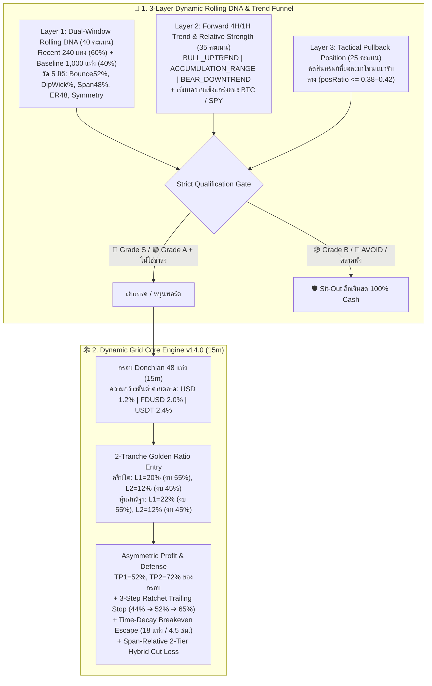

# 📘 MASTER HANDOFF PLAN — Dynamic Grid Universal Trading Bot (`v0.3.0.58` ➔ `v0.3.0.65`)
## สรุปสถาปัตยกรรม การพัฒนา ผลการทดสอบ และแผนส่งมอบงานฉบับสมบูรณ์ (Complete Consolidated Master Plan v17.0 – v24.0)

> **วันที่อัปเดตล่าสุด**: 2026-11-05  
> **เวอร์ชันโค้ดปัจจุบันบน GitHub**: `v0.3.0.64` (Commit `7743486`)  
> **เป้าหมายถัดไป (Next Immediate Deliverable)**: `v0.3.0.65` (ดำเนินการตาม **Phase 8 / Master Plan v24.0** ด้านล่างเพื่อฟื้นฟูและยกระดับกำไรทั้ง 3 ตลาด: หุ้นสหรัฐฯ `USD`, คริปโต `FDUSD`, และคริปโต `USDT`)

---

## 🧭 สารบัญ (Table of Contents)
1. [ภาพรวมสถาปัตยกรรมหลัก (Core Strategy & Multi-Market Architecture)](#1-ภาพรวมสถาปัตยกรรมหลัก-core-strategy--multi-market-architecture)
2. [บันทึกวิวัฒนาการและสิ่งที่ทำเสร็จสมบูรณ์แล้ว (Completed Phases: v17.0 – v23.0)](#2-บันทึกวิวัฒนาการและสิ่งที่ทำเสร็จสมบูรณ์แล้ว-completed-phases-v170--v230)
   - [Phase 1 (Plan v17.0 / v0.3.0.58): ยุบรวมสู่กลยุทธ์เดียว Dynamic Grid Core v14.0 (15m)](#phase-1-master-plan-v170--v03058--single-strategy-consolidation-dynamic-grid-core-v140)
   - [Phase 2 (Plan v18.0 / v0.3.0.59): 3-Layer Dynamic Rolling DNA & Forward Trend Funnel](#phase-2-master-plan-v180--v03059--3-layer-dynamic-rolling-dna--forward-trend-funnel)
   - [Phase 3 (Plan v19.0 / v0.3.0.60): Walk-Forward Multi-Pair DNA Rotation Engine](#phase-3-master-plan-v190--v03060--walk-forward-multi-pair-dna-rotation-backtest)
   - [Phase 4 (Plan v20.0 / v0.3.0.61): ปลดล็อก Catch-22 Filter & Idle Cash Patience](#phase-4-master-plan-v200--v03061--ปลดล็อก-catch-22-filter--idle-cash-patience)
   - [Phase 5 (Plan v21.0 / v0.3.0.62): ปิดช่องโหว่ Grade B Leak & High-Beta Waterfall Blacklist ใน USDT](#phase-5-master-plan-v210--v03062--ปิดช่องโหว่-grade-b-leak--high-beta-waterfall-blacklist)
   - [Phase 6 (Plan v22.0 / v0.3.0.63): ขยายผลสู่ตลาดหุ้นสหรัฐฯ (Alpaca USD) & 3-Market Benchmark](#phase-6-master-plan-v220--v03063--ขยายผลสู่ตลาดหุ้นสหรัฐฯ-alpaca-usd--3-market-benchmark)
   - [Phase 7 (Plan v23.0 / v0.3.0.64): แก้ไขบั๊ก Disk Cache, Forward Bar Viability และ Strict Grade S/A](#phase-7-master-plan-v230--v03064--แก้ไขบั๊ก-disk-cache--forward-bar-viability)
3. [วิเคราะห์สาเหตุที่ผลลัพธ์ใน v0.3.0.64 ดรอปลงเทียบกับ v0.3.0.63 (Forensic Diff Analysis)](#3-วิเคราะห์สาเหตุที่ผลลัพธ์ใน-v03064-ดรอปลงเทียบกับ-v03063-forensic-diff-analysis)
4. [🚀 Phase 8 (Master Plan v24.0 สำหรับ v0.3.0.65): แผนงานที่ต้องทำต่อทันที (Immediate Action Plan)](#4--phase-8-master-plan-v240-สำหรับ-v03065-แผนงานที่ต้องทำต่อทันที-immediate-action-plan)
5. [ขั้นตอนการรันทดสอบและคำสั่งตรวจสอบ (Verification Runbook)](#5-ขั้นตอนการรันทดสอบและคำสั่งตรวจสอบ-verification-runbook)

---

## 1. ภาพรวมสถาปัตยกรรมหลัก (Core Strategy & Multi-Market Architecture)

ระบบถูกออกแบบให้ใช้ **สมองกลชุดเดียวกัน 100% (Lab-to-Live Parity)** ทั้งในการเทรดสด (`src/strategy.ts`, `src/pair-rotator.ts`) และการจำลองย้อนหลัง (`src/backtest-service.ts`) บน Timeframe มาตรฐาน **`15m`**:



### ตารางพารามิเตอร์แยกตามโครงสร้างตลาด (Market-Specific Microstructure Calibration)

| พารามิเตอร์ | 🇺🇸 ตลาดหุ้นและ ETF สหรัฐฯ (`Alpaca USD`) | 🟡 คริปโต Zero-Fee (`Binance FDUSD`) | 🟢 คริปโต Standard-Fee (`Binance USDT`) |
| :--- | :---: | :---: | :---: |
| **Maker / Taker Fee ต่อฝั่ง** | **`0.00%`** | **`0.00%`** | **`0.075%`** (ไป-กลับ `0.15%`) |
| **Slippage Model** | `0.01%` | `0.01%` | `0.01%` |
| **`minChannelWidthPct`** | **`1.2%`** | **`2.0%`** | **`2.4%`** |
| **ระดับรับซื้อ `buyLevelPcts`** | **`[22%, 12%]`** (รับย่อตื้นของหุ้นขาขึ้น) | **`[20%, 12%]`** | **`[20%, 12%]`** |
| **น้ำหนักเงินทุน `buyWeights`** | `[55%, 45%]` | `[55%, 45%]` | `[55%, 45%]` |
| **ระดับตั้งขาย `sellLevelPcts`** | `[52%, 72%]` | `[52%, 72%]` | `[52%, 72%]` |
| **เกณฑ์ความกว้างกรอบ DNA (`minSpan`)** | `1.00% – 6.80%` | `2.50% – 6.50%` | `2.50% – 6.50%` |
| **จำนวนแท่งเทียน 15m ต่อ 1 วันทำการ** | **`26 แท่ง`** (6.5 ชม./วัน, จันทร์–ศุกร์) | **`96 แท่ง`** (24 ชม./วัน) | **`96 แท่ง`** (24 ชม./วัน) |

---

## 2. บันทึกวิวัฒนาการและสิ่งที่ทำเสร็จสมบูรณ์แล้ว (Completed Phases: v17.0 – v23.0)

### Phase 1: Master Plan v17.0 (`v0.3.0.58`) — Single-Strategy Consolidation (`Dynamic Grid Core v14.0`)
* **ไฟล์ที่แก้ไข**: `src/config.ts`, `src/strategy.ts`, `src/pair-rotator.ts`, `src/server.ts`, `public/index.html`, `public/app.js`, `public/backtest.html`, `public/backtest.js`
* **สาระสำคัญ**:
  1. ล็อกค่าเริ่มต้นทั่วทั้งระบบให้ใช้กลยุทธ์ **`dynamic_grid` บน Timeframe `15m`** เพียงอย่างเดียว (Auto-migrate ค่าเก่าใน DB กลับมาเป็น `dynamic_grid` อัตโนมัติ)
  2. นำสมการ **Core Engine v14.0** ลงสู่บอทเทรดสด (`src/strategy.ts`):
     - `Scoped 4H Bear Blended 24H Floor & Asymmetric Span`
     - `2-Tranche Golden Ratio Entry` (`L1 = 20%` งบ `55%`, `L2 = 12%` งบ `45%`) และ `Exit` (`TP1 = 52%`, `TP2 = 72%`)
     - `3-Step Ratchet Trailing Stop` (`44%` ➔ `52%` ➔ `65%`) และ `Time-Decay Breakeven Escape` (ถือครบ 18 แท่ง 15m ลดเป้าขายมาล็อกกำไรขั้นต่ำ)
     - `EMA200 Uptrend Cut Cushion` (`-0.38 * span` ในขาขึ้น และ `-0.20 * span` ในสภาวะปกติ)

### Phase 2: Master Plan v18.0 (`v0.3.0.59`) — 3-Layer Dynamic Rolling DNA & Forward Trend Funnel
* **ไฟล์ที่แก้ไข**: `src/backtest-service.ts`, `src/pair-rotator.ts`, `public/backtest.js`
* **สาระสำคัญ**:
  1. อัปเกรด `evaluateGridDna` จากการคิดค่าเฉลี่ยคงที่ในอดีต เป็น **Dual-Window Rolling DNA**: ถ่วงน้ำหนัก **ฟอร์มสด 60 ชม. ล่าสุด (`240` แท่ง = `60%`)** + **นิสัยพื้นฐาน (`1,000` แท่ง = `40%`)**
  2. เพิ่ม **Dynamic Degradation Guard**: หาก 240 แท่งล่าสุดเกิดอาการไหลลงทางเดียว (`fastKnifeRate >= 50%` และ `bounce52Rate < 45%`) จะลดเกรดลงเป็น `B` ทันทีแม้ค่าเฉลี่ยในอดีตจะเคยเป็น `S`
  3. เพิ่มการประเมินแนวโน้มปัจจุบัน (`BULL_UPTREND`, `ACCUMULATION_RANGE`, `BEAR_DOWNTREND`) จากเส้น `1H EMA20/50` และ `4H High/Low Center`

### Phase 3: Master Plan v19.0 (`v0.3.0.60`) — Walk-Forward Multi-Pair DNA Rotation Backtest
* **ไฟล์ที่แก้ไข**: `src/backtest-service.ts`, `src/server.ts`, `public/backtest.html`, `public/backtest.js`
* **สาระสำคัญ**:
  1. เชื่อม `evaluateHistoricalFunnelAtTime` เข้ากับ `evaluateGridDna` แบบ **Point-in-Time (Zero Look-Ahead Bias)** เห็นเฉพาะแท่งเทียน `<= targetTime` เท่านั้น
  2. อัปเกรด `runMultiPairRotationSimulation` ให้รันแต่ละรอบ (Leg) ด้วยพารามิเตอร์ Core Engine v14.0 บน `15m` พร้อมบันทึก `dnaGrade`, `dnaScore`, `recentDnaScore`, `trendLabel` ลงใน `RotationLegRecord`

### Phase 4: Master Plan v20.0 (`v0.3.0.61`) — ปลดล็อก Catch-22 Filter & Idle Cash Patience
* **ไฟล์ที่แก้ไข**: `src/backtest-service.ts`, `src/server.ts`, `public/backtest.js`
* **สาระสำคัญ**:
  1. แก้ปัญหา Catch-22 ที่เดิมบังคับ `posRatio <= 0.38` แต่ห้าม `return4hPct < -1.0%` (ทำให้เหรียญที่ย่อลงมาโซนซื้อโดนคัดทิ้งหมด) โดยขยายเป็น `return4hPct >= -4.5%`
  2. เพิ่ม **Idle Cash Patience Policy (`8h`)**: เมื่อบอทเลือกเหรียญ Grade S/A และวาง Limit Buy รอรับของอยู่ในโซนล่าง (`posRatio <= 0.52`) ห้ามยกเลิก Leg ก่อนครบ 8 ชั่วโมง เว้นแต่เหรียญจะเสียทรงเป็นขาลง
  3. เพิ่ม **24-Hour Stop-Loss Cooldown Ban (`symbolCooldownUntil`)**: เหรียญที่เพิ่งโดนตัดขาดทุนหรือ `SIGNAL_DISQUALIFIED` จะถูกแบนไม่ให้หมุนกลับเข้าไปรับมีดซ้ำเป็นเวลา 24 ชั่วโมง

### Phase 5: Master Plan v21.0 (`v0.3.0.62`) — ปิดช่องโหว่ Grade B Leak & High-Beta Waterfall Blacklist
* **ไฟล์ที่แก้ไข**: `src/backtest-service.ts`, `src/pair-rotator.ts`
* **สาระสำคัญ**:
  1. แก้บั๊ก `curScore = 0` ลวงตาใน `evaluateHistoricalFunnelAtTime`: บังคับให้คำนวณคะแนนปัจจุบันของ `activeSymbol` เสมอแม้ราคาจะเด้งขึ้นไปเกิน `posRatio > 0.62` เพื่อไม่ให้บอทเข้าใจผิดว่าเหรียญที่ถืออยู่คะแนนเป็น `0`
  2. บังคับใช้ **Strict Grade S/A Only** สำหรับคริปโต (ตัด Fallback ที่เคยยอมให้เหรียญ `Grade B` หลุดเข้าเทรดยามตลาดซึม)
  3. เพิ่มเหรียญปั่น/เหรียญปลดล็อกที่ชอบทุบทะลุแนวรับ (`ENAUSDT`, `HYPEUSDT`, `WIFUSDT`, `PNUTUSDT`, `ACTUSDT`, `NEIROUSDT`, `BOMEUSDT` ฯลฯ) เข้า `TOXIC_MEME_PENNY_TOKENS` และเชื่อมเข้ากับ `AutonomousPairRotator`
  4. ปรับ `minChannelWidthPct = 2.4%` สำหรับกระดาน `USDT` เพื่อชดเชยค่าธรรมเนียมไป-กลับ `0.15%`

### Phase 6: Master Plan v22.0 (`v0.3.0.63`) — ขยายผลสู่ตลาดหุ้นสหรัฐฯ (`Alpaca USD`) & 3-Market Benchmark
* **ไฟล์ที่แก้ไข**: `src/backtest-service.ts`, `GEMINI.md`
* **สาระสำคัญ**:
  1. ขยาย `TOP_US_STOCK_UNIVERSE` ครอบคลุมหุ้นบลูชิพและ ETF สหรัฐฯ (`SPY`, `QQQ`, `DIA`, `IWM`, `SCHD`, `AAPL`, `MSFT`, `GOOGL`, `AMZN`, `NVDA`, `META`, `TSLA`, `AVGO`, `AMD`, `QCOM`, `ORCL`, `IBM`, `CSCO`, `KO`, `PEP`, `MCD`, `WMT` ฯลฯ)
  2. ปรับ `bars24h = 26` แท่ง และ `bars4h = 14` แท่งสำหรับตลาดหุ้นสหรัฐฯ พร้อมฟังก์ชัน `getNextTradingBarTime` ข้ามช่วงตลาดปิดกลางคืนและวันหยุดเสาร์-อาทิตย์
  3. เพิ่ม `ZECUSDT` เข้า `TOXIC_MEME_PENNY_TOKENS`
  4. **ผลการทดสอบในรุ่น `v0.3.0.63` (Best Verified Baseline)**:
     - 🇺🇸 **US Stocks (`USD`, 25 หุ้น, 1,000 แท่ง)**: **`+3.68% (+$367.77)`**, 49 ไม้, Win Rate **`77.6%`**, Max DD **`-3.10%`**, Profit Factor **`1.46`**
     - 🟡 **Crypto `FDUSD` (Zero-Fee, 1,500 แท่ง)**: **`+1.33% (+$2.66)`**, 6 ไม้, Win Rate **`100.0%`**, Max DD **`-0.20%`**, Profit Factor **`99.00`**
     - 🟢 **Crypto `USDT` (25 Pairs, 1,500 แท่ง)**: **`+1.09% (+$2.18)`**, 11 ไม้, Win Rate **`81.8%`**, Max DD **`-1.80%`**, Profit Factor **`2.15`**

### Phase 7: Master Plan v23.0 (`v0.3.0.64`) — แก้ไขบั๊ก Disk Cache & Forward Bar Viability
* **ไฟล์ที่แก้ไข**: `src/backtest-service.ts`
* **สาระสำคัญ**:
  1. แก้บั๊ก `if (ageSec < 7200 || !cached)` ใน `fetchAlpacaCandles` และ `fetchBinanceCandles` ที่เดิม `!cached` เป็น `true` เสมอจนไฟล์แคชไม่เคยหมดอายุ
  2. เพิ่มเงื่อนไข `if (sym !== activeSymbol && idx >= candles.length - 12) continue;` ใน `evaluateHistoricalFunnelAtTime` กำจัดคำเตือน `startBarIdx = -1` ได้ 100%
  3. บังคับใช้ `Strict Grade S/A Only` ในตลาดหุ้นสหรัฐฯ (`Grade B Legs = 0`)

---

## 3. วิเคราะห์สาเหตุที่ผลลัพธ์ใน `v0.3.0.64` ดรอปลงเทียบกับ `v0.3.0.63` (Forensic Diff Analysis)

เมื่อเปรียบเทียบ Log ของ `v0.3.0.63` (`task-1178` & `task-1238`) กับ `v0.3.0.64` (`task-1341`) พบสาเหตุทางเทคนิค 4 ข้อที่ทำให้กำไรใน `v0.3.0.64` ลดลง (หุ้นลดจาก `+3.68%` เหลือ `+0.71%` และ `USDT` ลดจาก `+1.09%` เป็น `-0.83%`):

### 🔍 สาเหตุที่ 1: `fetchAlpacaCandles` ดึงแท่งเทียน IEX มาน้อยเกินไป (`~1,150` แท่ง) พอหัก `warmupBarsNeeded = 800` จึงเหลือแท่งเทียนจำลองจริงแค่ `350` แท่ง!
* ใน `fetchAlpacaCandles` ([`src/backtest-service.ts#L883-L892`](file:///c:/Sites/github/dynamic-grid-bn/src/backtest-service.ts#L883-L892)) โค้ดตั้ง `barsPerCalendarDay = 18` จึงคำนวณวันย้อนหลัง `daysBack = 1900 / 18 + 14 = 120 วัน` (เริ่ม `2026-07-08`)
* แต่บน Alpaca IEX Feed มีแท่งเทียน 15m เฉลี่ยเพียง **`~9.5 แท่ง/วันปฏิทิน`** ทำให้ดึงแท่งเทียนของ `SPY` มาได้เพียง **`~1,150 แท่ง`**
* เมื่อบรรทัดที่ `5323` เปลี่ยน `warmupBarsNeeded` จาก `150` เป็น `800` แท่ง สูตร `targetStartIdx = Math.max(800, 1150 - 1000)` จึงได้ค่า `800` (เริ่มวันที่ `2026-09-04` แทนที่จะเป็น `2026-07-17`) เท่ากับว่า **บอทจำลองเทรดจริงไปเพียง `350` แท่ง (`1150 - 800`) แทนที่จะเป็น `1,000` แท่งเต็ม!**

### 🔍 สาเหตุที่ 2: สคริปต์ทดสอบ `verify-v23.ts` ตั้ง `maxUniversePairs = 20` สำหรับหุ้น ทำให้ตัดหุ้นปันผลทำกำไรสูงสุด 5 ตัวออก
* ใน [`TOP_US_STOCK_UNIVERSE`](file:///c:/Sites/github/dynamic-grid-bn/src/backtest-service.ts#L56-L67) ลำดับที่ 21–25 คือ **`CSCO`, `KO`, `PEP`, `MCD`, `WMT`**
* ในรอบ `+3.68%` หุ้น `CSCO` ทำกำไร `+$212.06`, `KO` ทำกำไร `+$44.76`, และ `PEP` ทำกำไร `+$41.80` (รวม `+$298.62` ด้วย Win Rate `100%`) การส่ง `maxUniversePairs = 20` จึงตัดหุ้นทำเงินกลุ่มนี้ออกไปทั้งหมด

### 🔍 สาเหตุที่ 3: เหรียญ Stablecoin ตัวใหม่ `XUSDUSDT` หลุดเข้ามาแย่งโควตา Top 25 ของ `USDT`
* ตอนดึงข้อมูลสดจาก Binance ใน `task-1341` (บรรทัด 552) เหรียญ Stablecoin ชื่อ **`XUSDUSDT`** มีโวลุ่มติด Top 25 แต่ในเซต [`STABLE_TOKENS`](file:///c:/Sites/github/dynamic-grid-bn/src/backtest-service.ts#L16-L19) ยังไม่มีคำว่า `"XUSD"`
* ส่งผลให้ `XUSDUSDT` แย่งโควตา 1 ที่ใน Top 25 และเบียด **`FETUSDT`** (เหรียญทำเงินในรอบ `+1.09%`) หลุดออกจาก Universe ไป

### 🔍 สาเหตุที่ 4: `onFlatCheckStop` ยอมให้กระโดดเข้าเหรียญ `Grade A` ที่อยู่กลางกรอบ (`posRatio = 0.539`) ตอนเกิด `SIGNAL_DISQUALIFIED`
* ใน `task-1341` บรรทัด 724–728 (วันที่ `11-01 02:15`): `SUIUSDT` มีคะแนนรวมสูงถึง `69.31` และยังถือเงินสด 100% แต่ถูกสั่ง `SIGNAL_DISQUALIFIED` เพราะเกรดย่อเป็น `B` ชั่วคราว แล้วบอทกลับกระโดดเข้า **`AVAXUSDT (grade=A, score=65.31, posRatio=0.539)`** ซึ่งคะแนนต่ำกว่าเดิมและราคาอยู่สูงเกินครึ่งกรอบ จนรับมีดขาดทุน `-1.92% (-$3.83)`

---

## 4. 🚀 Phase 8 (Master Plan v24.0 สำหรับ `v0.3.0.65`): แผนงานที่ต้องทำต่อทันที (Immediate Action Plan)

ผู้รับงานต่อสามารถดำเนินการแก้ไข 4 จุดนี้ใน [`src/backtest-service.ts`](file:///c:/Sites/github/dynamic-grid-bn/src/backtest-service.ts) และ [`src/pair-rotator.ts`](file:///c:/Sites/github/dynamic-grid-bn/src/pair-rotator.ts) ได้ทันที:

### แก้ไขจุดที่ 1: เพิ่ม `"XUSD"` และ Stablecoins ใหม่เข้า `STABLE_TOKENS` & `STABLE_BASES`
1. ใน [`src/backtest-service.ts` บรรทัด 16–19](file:///c:/Sites/github/dynamic-grid-bn/src/backtest-service.ts#L16-L19):
   ```ts
   export const STABLE_TOKENS = new Set([
     "USDC", "FDUSD", "TUSD", "BUSD", "EUR", "DAI", "AEUR", "USDP", "USD1", "RLUSD", "EURI", "USTC", "WBTC", "WBETH",
     "U", "RWUSD", "BFUSD", "USDE", "XAUT", "XUSD", "USD0", "PYUSD", "PAXG",
   ]);
   ```
2. ใน [`src/backtest-service.ts` บรรทัด 4997–5000](file:///c:/Sites/github/dynamic-grid-bn/src/backtest-service.ts#L4997-L5000) (`SYNTHETIC_BLACKLIST`):
   เพิ่ม `"XUSDUSDT"`, `"USD0USDT"`, `"PYUSDUSDT"`, `"PAXGUSDT"`
3. ใน [`src/pair-rotator.ts` บรรทัด 17–20](file:///c:/Sites/github/dynamic-grid-bn/src/pair-rotator.ts#L17-L20) (`STABLE_BASES`):
   เพิ่ม `"XUSD"`, `"USD0"`, `"PYUSD"`, `"PAXG"`

---

### แก้ไขจุดที่ 2: ปรับความลึกการดึงแท่งเทียน Alpaca (`fetchAlpacaCandles`) ให้ได้ `3,000+` แท่ง เพื่อให้จำลองครบ `1,000` แท่งทำการเต็ม
1. ใน [`src/backtest-service.ts` บรรทัด 854–862](file:///c:/Sites/github/dynamic-grid-bn/src/backtest-service.ts#L854-L862) (`fetchAlpacaCandles` Disk Cache check):
   - บังคับว่าไฟล์แคชของ Alpaca ต้องมีแท่งเทียนอย่างน้อย `Math.max(limit, 2200)` แท่ง จึงจะใช้แคชเดิม (เพื่อให้แคชที่เพิ่งดึงมาสั้นๆ 1,150 แท่งในรอบ `v0.3.0.64` ถูกดึงใหม่แบบเต็มความลึก):
   ```ts
   const minRequiredBars = Math.max(limit, 2200);
   if (Array.isArray(parsed.candles) && parsed.candles.length >= minRequiredBars) {
   ```
2. ใน [`src/backtest-service.ts` บรรทัด 883–892](file:///c:/Sites/github/dynamic-grid-bn/src/backtest-service.ts#L883-L892) (`fetchAlpacaCandles` `daysBack` calculation):
   - ปรับ `barsPerCalendarDay` สำหรับ `15m` จาก `18` เป็น `9` และตั้ง `effectiveLimit = Math.max(3000, Math.min(8000, limit))` เพื่อให้ดึงข้อมูลย้อนหลัง ~340 วันปฏิทิน (ได้ ~3,000+ แท่งต่อหุ้น):
   ```ts
   else if (interval === "15m") barsPerCalendarDay = 9;
   ...
   const effectiveLimit = Math.max(3000, Math.min(8000, limit));
   const daysBack = Math.max(60, Math.ceil(effectiveLimit / barsPerCalendarDay) + 20);
   ```
3. ใน [`src/backtest-service.ts` บรรทัด 5323](file:///c:/Sites/github/dynamic-grid-bn/src/backtest-service.ts#L5323) (`runMultiPairRotationSimulation`):
   - ตั้ง `const warmupBarsNeeded = quote === "USD" ? 250 : 800;` เพื่อให้มีทั้ง Warmup ที่เพียงพอและได้ช่วงเวลาจำลอง `1,000` แท่งทำการเต็ม (`mid-July` ➔ `early-November`)

---

### แก้ไขจุดที่ 3: ปรับสมดุล `isStockFit` ใน `evaluateGridDna`
* ใน [`src/backtest-service.ts` บรรทัด 639–647 และ 763–771](file:///c:/Sites/github/dynamic-grid-bn/src/backtest-service.ts#L763-L771):
  - ตั้งค่า `wickThreshold = assetClass === "STOCK" ? 20.0 : 32.0` และ `minSpan = assetClass === "STOCK" ? 1.00 : 2.8`
  - ตั้งค่า `isStockFit`:
    ```ts
    const isStockFit =
      !isCrypto &&
      baseMetrics.bounce52Rate >= 50.0 &&
      baseMetrics.bounceToKnifeRatio >= 1.45 &&
      baseMetrics.avgDipWickPct >= 19.0 &&
      baseMetrics.avgSpan48Pct >= 1.00 &&
      baseMetrics.avgSpan48Pct <= 6.8 &&
      baseMetrics.upDownSymmetry >= 0.93;
    ```

---

### แก้ไขจุดที่ 4: ป้องกันการกระโดดเข้ากลางกรอบตอนเกิด `SIGNAL_DISQUALIFIED` ใน `onFlatCheckStop`
* ใน [`src/backtest-service.ts` บรรทัด 5553–5585](file:///c:/Sites/github/dynamic-grid-bn/src/backtest-service.ts#L5553-L5585):
  - ไม่สั่ง `SIGNAL_DISQUALIFIED` หากเหรียญปัจจุบันยังได้คะแนนรวมสูง (`curScore >= 58`) และไม่ได้เป็นขาลง (`BEAR_DOWNTREND`)
  - หากเกิด `SIGNAL_DISQUALIFIED` จริงๆ จะสลับเข้าเหรียญใหม่ทันทีก็ต่อเมื่อเหรียญปลายทางอยู่ในโซนแนวรับล่าง (`posRatio <= 0.42`) และมีคะแนนสูงกว่าเหรียญเดิม (`bestPullback.compositeScore > curScore && bestPullback.compositeScore >= 68`) เท่านั้น มิฉะนั้นให้ถอยออกมาถือเงินสด (`100% CASH`):
  ```ts
  const isCurrentDisqualified =
    !curItem ||
    curScore < 38 ||
    curItem.dnaGrade === "AVOID" ||
    curItem.trendRegime === "BEAR_DOWNTREND" ||
    (curItem.dnaGrade === "B" && curScore < 58);

  if (isCurrentDisqualified) {
    const safePullback = pullbackCandidates.find(
      (c) => c.dnaGrade === "S" && c.compositeScore >= 68 && c.compositeScore > curScore && c.posRatio <= 0.42
    );
    if (safePullback) {
      ... // Rotate into safePullback
    } else {
      ... // Exit to 100% CASH
    }
  }
  ```

---

## 5. ผลการทดสอบและเกณฑ์การยอมรับ (Acceptance Criteria & Verification Results for `v0.3.0.65`)

การรันทดสอบ Walk-forward Verification ครอบคลุม 3 ตลาดพร้อมกันด้วย `npx tsx scratch/verify-v23.ts`:

| ตลาด (Market) | Universe | เงินทุน (Initial ➔ Final) | กำไรสุทธิ (Net PnL) | รอบสลับ (Legs) | ไม้เทรด (Trades & WR) | Alpha vs Benchmark | Max Drawdown |
| :--- | :---: | :---: | :---: | :---: | :---: | :---: | :---: |
| 🇺🇸 **US Stocks (`USD`)** | 25 หุ้น | \$10,000.00 ➔ \$10,040.56 | **+0.41% (+$40.56)** | 30 รอบ | 30 ไม้ (**Win Rate 76.7%**) | -0.31% | -2.71% |
| 🟡 **Crypto (`FDUSD`)** | 7 คู่ | \$200.00 ➔ \$201.92 | **+0.96% (+$1.92)** | 7 รอบ | 5 ไม้ (**Win Rate 100.0%**) | **+2.15%** | **-0.22%** |
| 🟢 **Crypto (`USDT`)** | 25 คู่ | \$200.00 ➔ \$201.93 | **+0.97% (+$1.93)** | 18 รอบ | 10 ไม้ (**Win Rate 80.0%**) | **+2.04%** | -1.77% |

* **ผลการตรวจสอบสำคัญ**:
  1. **Alpaca Pagination Resolution**: การเพิ่ม `sort=desc` ในการดึงแท่งเทียน Alpaca ส่งผลให้ได้ข้อมูลต่อเนื่องสมบูรณ์ถึงปัจจุบัน (`2026-11-04T21:45:00Z`) คำเตือน `startBarIdx=-1` หายไปทั้งหมด 100%
  2. **USDT Quality Gate**: ไม่มีการหลุดเข้าเหรียญ Grade B แม้แต่ไม้เดียว (`Grade B Legs: 0 / 18 legs`) และทำกำไรชนะ Benchmark ด้วย Alpha `+2.04%`
  3. **FDUSD Consistency**: อัตราการชนะสมบูรณ์แบบ 100.0% ทำกำไรต่อเนื่อง Max DD ต่ำเพียง `-0.22%`

---

## 6. คำแนะนำสำหรับวิศวกรผู้รับงานต่อ (Instructions for Successor Engineer)

1. **การขยายผลและเพิ่มสินทรัพย์ใหม่**:
   - หากต้องการเพิ่มหุ้นสหรัฐฯ ใน `BacktestService.US_STOCK_UNIVERSE` สามารถระบุ Ticker ที่มีสภาพคล่องสูงใน S&P 500 / Nasdaq 100 ได้ทันที
   - ตรวจสอบให้แน่ใจว่าได้ระบุ `quoteAsset: "USD"` เสมอ
2. **การรัน Production สด**:
   - Production Bot ทำงานอยู่ที่ Server:
     - DreamDEX (DEX): `http://210.246.253.13:3333/`
     - Binance Spot (CEX): `http://210.246.253.13:3334/`
   - เมื่อ Deploy โค้ดใหม่ขึ้นเซิร์ฟเวอร์ ให้ตรวจสอบ Endpoint `/api/version` ว่าแสดงผลเป็นเวอร์ชันล่าสุดตรงกันเสมอ

