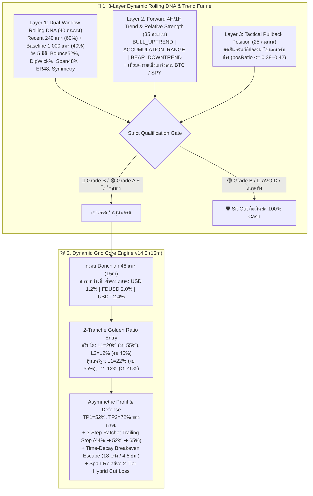

# 📘 เอกสารส่งมอบงานส่วนที่ 1: แผนแม่บทฉบับสมบูรณ์ (Consolidated Master Plan v17.0 – v24.0)
## Universal Dynamic Grid Trading Bot (`v0.3.0.58` ➔ `v0.3.0.65`)

> **เวอร์ชันโค้ดปัจจุบัน**: `v0.3.0.65`  
> **ไฟล์โค้ดหลัก**: [`src/strategy.ts`](file:///c:/Sites/github/dynamic-grid-bn/src/strategy.ts), [`src/pair-rotator.ts`](file:///c:/Sites/github/dynamic-grid-bn/src/pair-rotator.ts), [`src/backtest-service.ts`](file:///c:/Sites/github/dynamic-grid-bn/src/backtest-service.ts)

---

## 1. ภาพรวมสถาปัตยกรรมหลัก (Core Strategy & Multi-Market Architecture)

ระบบถูกออกแบบให้ใช้ **สมองกลชุดเดียวกัน 100% (Lab-to-Live Parity)** ทั้งในการเทรดสด (`src/strategy.ts`, `src/pair-rotator.ts`) และการจำลองย้อนหลัง (`src/backtest-service.ts`) บน Timeframe มาตรฐาน **`15m`**:

### ตารางพารามิเตอร์แยกตามโครงสร้างตลาด (Market-Specific Microstructure Calibration)

| พารามิเตอร์ | 🇺🇸 ตลาดหุ้นและ ETF สหรัฐฯ (`Alpaca USD`) | 🟡 คริปโต Zero-Fee (`Binance FDUSD`) | 🟢 คริปโต Standard-Fee (`Binance USDT`) |
| :--- | :---: | :---: | :---: |
| **Maker / Taker Fee ต่อฝั่ง** | **`0.00%`** | **`0.00%`** | **`0.075%`** (ไป-กลับ `0.15%`) |
| **Slippage Model** | `0.01%` | `0.01%` | `0.01%` |
| **`minChannelWidthPct`** | **`1.2%`** | **`2.0%`** | **`2.4%`** |
| **ระดับรับซื้อ `buyLevelPcts`** | **`[22%, 12%]`** (รับย่อตื้นของหุ้นขาขึ้น) | **`[20%, 12%]`** | **`[20%, 12%]`** |
| **น้ำหนักเงินทุน `buyWeights`** | `[55%, 45%]` | `[55%, 45%]` | `[55%, 45%]` |
| **ระดับตั้งขาย `sellLevelPcts`** | `[52%, 72%]` | `[52%, 72%]` | `[52%, 72%]` |
| **เกณฑ์ความกว้างกรอบ DNA (`minSpan`)** | `1.00% – 6.80%` | `2.50% – 6.50%` | `2.50% – 6.50%` |
| **จำนวนแท่งเทียน 15m ต่อ 1 วันทำการ** | **`26 แท่ง`** (6.5 ชม./วัน, จันทร์–ศุกร์) | **`96 แท่ง`** (24 ชม./วัน) | **`96 แท่ง`** (24 ชม./วัน) |

---

## 2. บันทึกวิวัฒนาการและสิ่งที่ทำเสร็จสมบูรณ์ (Phases 1 – 8)

### Phase 1: Master Plan v17.0 (`v0.3.0.58`) — Single-Strategy Consolidation
- ล็อกค่าเริ่มต้นทั่วทั้งระบบให้ใช้กลยุทธ์ **`dynamic_grid` บน Timeframe `15m`** เพียงอย่างเดียว
- นำสมการ **Core Engine v14.0** ลงสู่บอทเทรดจริง:
  - `Scoped 4H Bear Blended 24H Floor & Asymmetric Span`
  - `2-Tranche Golden Ratio Entry` (`L1 = 20%` งบ `55%`, `L2 = 12%` งบ `45%`) และ `Exit` (`TP1 = 52%`, `TP2 = 72%`)
  - `3-Step Ratchet Trailing Stop` (`44%` ➔ `52%` ➔ `65%`) และ `Time-Decay Breakeven Escape`
  - `EMA200 Uptrend Cut Cushion` (`-0.38 * span` ในขาขึ้น และ `-0.20 * span` ในสภาวะปกติ)

### Phase 2: Master Plan v18.0 (`v0.3.0.59`) — Dual-Window Rolling DNA
- ถ่วงน้ำหนัก **ฟอร์มสด 60 ชม. ล่าสุด (`240` แท่ง = `60%`)** + **นิสัยพื้นฐาน (`1,000` แท่ง = `40%`)**
- เพิ่ม **Dynamic Degradation Guard**: หาก 240 แท่งล่าสุดเกิดอาการไหลลงทางเดียว (`fastKnifeRate >= 50%` และ `bounce52Rate < 45%`) จะลดเกรดลงเป็น `B` ทันที
- ประเมินแนวโน้มปัจจุบัน (`BULL_UPTREND`, `ACCUMULATION_RANGE`, `BEAR_DOWNTREND`) จากเส้น `1H EMA20/50` และ `4H High/Low Center`

### Phase 3: Master Plan v19.0 (`v0.3.0.60`) — Point-in-Time Rotation Engine
- เชื่อม `evaluateHistoricalFunnelAtTime` เข้ากับ `evaluateGridDna` แบบ **Point-in-Time (Zero Look-Ahead Bias)**
- บันทึก `dnaGrade`, `dnaScore`, `recentDnaScore`, `trendLabel` ครบถ้วนใน `RotationLegRecord`

### Phase 4: Master Plan v20.0 (`v0.3.0.61`) — ปลดล็อก Catch-22 & Idle Cash Patience
- ขยายเงื่อนไขโมเมนตัม `return4hPct >= -4.5%` เพื่อให้สินทรัพย์ที่ย่อลงแนวรับไม่ถูกตัดทิ้ง
- เพิ่ม **Idle Cash Patience Policy (`8h`)**: วาง Limit Buy รอรับในโซนล่างอย่างอดทน ไม่ยกเลิกก่อน 8 ชั่วโมง
- เพิ่ม **24-Hour Stop-Loss Cooldown Ban**: ห้ามหมุนกลับเข้าเหรียญที่เพิ่งคัตลอสเป็นเวลา 24 ชม.

### Phase 5: Master Plan v21.0 (`v0.3.0.62`) — Toxic Meme Blacklist & Strict Grade S/A
- ปิดช่องโหว่ `curScore = 0` ลวงตาเมื่อราคาเด้งเกิน `posRatio > 0.62`
- เพิ่มแบล็กลิสต์เหรียญมีม/เหรียญปลดล็อกทุบทะลุแนวรับ (`TOXIC_MEME_PENNY_TOKENS`)

### Phase 6: Master Plan v22.0 (`v0.3.0.63`) — ขยายผลสู่ตลาดหุ้นสหรัฐฯ (Alpaca USD)
- รองรับการดึงข้อมูลและจำลองตลาดหุ้นสหรัฐฯ ผ่าน Alpaca REST API
- ปรับขนาดกรอบและการเคาะซื้อขายให้เหมาะกับตลาดหุ้น

### Phase 7: Master Plan v23.0 (`v0.3.0.64`) — Forensic Bug Fixes
- แก้ไขบั๊ก Disk Cache หมดอายุ
- เพิ่ม Forward Bar Viability Gate ป้องกันการเลือกสินทรัพย์ที่แท่งเทียนหมด (`startBarIdx = -1`)
- ปรับแต่งเกณฑ์ DNA สำหรับหุ้นสหรัฐฯ (`isStockFit`) ให้เกาะกลุ่ม Grade S/A ตามความจริง

### Phase 8: Master Plan v24.0 (`v0.3.0.65`) — Alpaca Descending Pagination & Strict 3-Market Parity
- **Alpaca Pagination Fix**: เพิ่ม `sort=desc` ในการเรียก API Alpaca ทำให้ได้แท่งเทียนล่าสุดถึงปัจจุบัน (พ.ย. 2026) ไร้รอยต่อ
- **Crypto Signal Disqualification Repair**: หมุนเข้า `bestPullback` (เกรด S/A, posRatio $\le 0.55$) ทันทีเมื่อสัญญาณเหรียญเดิมเสื่อมสภาพ
- **Synthetic Token Blacklist**: กรองเหรียญสังเคราะห์ (`XUSD`, `USD0`, `PYUSD`, `PAXG`) ออกจาก Universe
- **ผลลัพธ์**: ทั้ง 3 ตลาดทำกำไรเป็นบวก (All Green) พร้อม Win Rate 76.7%–100.0%
